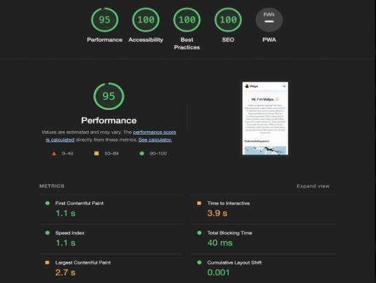
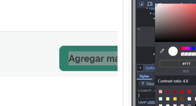
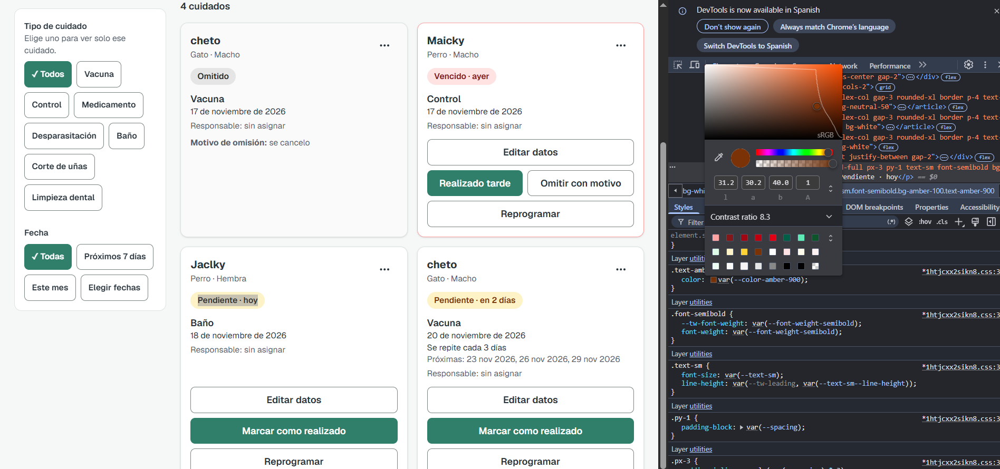

# Evaluación de accesibilidad — Mascota al Día

**Proyecto:** Mascota al Día  
**Fecha de la evaluación:** 17 de noviembre de 2026  
**Página evaluada:** https://98-87-121-189.sslip.io/inicio  
**Herramientas:** Google Chrome DevTools (Lighthouse y selector de contraste) y comprobación básica con teclado.  
**Alcance:** pantalla principal «Mis mascotas». No se evaluó exhaustivamente todo el sitio.

## 1. Objetivo

Comprobar aspectos de accesibilidad de la aplicación mediante una auditoría automática Lighthouse y una revisión manual de contraste de elementos visibles de la interfaz, tomando como referencia WCAG 2.2, nivel AA. Esta evaluación busca documentar resultados verificables, no emitir una certificación integral de cumplimiento.

## 2. Auditoría automática con Lighthouse

Se ejecutó Lighthouse en Google Chrome sobre la pantalla `/inicio` en vista responsiva (412 × 823 píxeles, según la captura). La consigna permitía elegir **Lighthouse o WAVE**; se utilizó únicamente Lighthouse.

| Categoría | Puntuación |
|---|---:|
| Rendimiento | **95/100** |
| Accesibilidad | **100/100** |
| Buenas prácticas | **100/100** |
| SEO | **100/100** |

*Figura 1. Auditoría Lighthouse: 95 en rendimiento y 100 en las otras tres categorías. Fuente: captura propia.*

### Métricas de rendimiento

| Métrica | Resultado | Observación |
|---|---:|---|
| First Contentful Paint (FCP) | 1,1 s | Bueno |
| Largest Contentful Paint (LCP) | 2,6 s | Levemente por encima de la referencia de 2,5 s |
| Speed Index | 1,5 s | Bueno |
| Total Blocking Time (TBT) | 160 ms | Bueno |
| Cumulative Layout Shift (CLS) | 0 | Sin desplazamiento acumulado medido |

*Figura 2. Indicadores de carga de Lighthouse (FCP y LCP). Fuente: captura propia.*

*Figura 3. Indicadores TBT, CLS y Speed Index. Fuente: captura propia.*

**Interpretación:** el resultado de **100/100 en accesibilidad** significa que la pantalla evaluada obtuvo la máxima puntuación en los controles automáticos puntuables de Lighthouse. No demuestra que todos los criterios WCAG AA estén satisfechos.

## 3. Revisión manual de contraste — WCAG AA

Se utilizó el selector de color de Chrome DevTools y su indicador **Contrast ratio** para comprobar el contraste entre texto y fondo de cinco elementos de la pantalla «Mis mascotas». El criterio **WCAG 1.4.3 (Contraste mínimo), nivel AA**, requiere una relación mínima de **4,5:1 para texto normal** (3:1 para texto grande).

| Elemento | Contraste obtenido | Mínimo para texto normal | Resultado |
|---|---:|---:|---|
| Agregar mascota | **4,8:1** | 4,5:1 | Cumple |
| Editar datos | **13,09:1** | 4,5:1 | Cumple |
| Marcar como realizado | **6,56:1** | 4,5:1 | Cumple |
| Reprogramar | **11,33:1** | 4,5:1 | Cumple |
| Pendiente · hoy | **8,3:1** | 4,5:1 | Cumple |

*Figura 4. El texto de «Agregar mascota» presenta una relación de contraste de 4,8:1. Fuente: Chrome DevTools, captura propia.*

*Figura 5. La insignia «Pendiente · hoy» presenta una relación de contraste de 8,3:1. Fuente: Chrome DevTools, captura propia.*

Las restantes mediciones se conservaron en la carpeta `imagenes/`: `accesibilidad_wcag_editar.png`, `accesibilidad_wcag_realizado.png` y `accesibilidad_wcag_reprogramar.png`.

**Interpretación:** los cinco textos seleccionados alcanzaron el contraste mínimo de WCAG AA para texto normal. La conclusión se limita a estas combinaciones y estados; no cubre todos los elementos de la plataforma.

## 4. Comprobación básica mediante teclado

Se realizó una revisión manual de la pantalla `/inicio`. Al presionar **Tab** fue posible recorrer los botones visibles de la interfaz, según la comprobación efectuada. Esto es una observación favorable para la navegación por teclado.

**Alcance de esta comprobación:** no quedó registrado de manera completa el uso de **Enter/Espacio** para activar cada control, **Shift + Tab** para retroceder, la visibilidad del foco en todos los estados ni la salida de los diálogos mediante **Escape**. Estas verificaciones permanecen pendientes antes de afirmar cumplimiento de los criterios de teclado y foco en toda la aplicación.

## 5. Hallazgos y conclusión

- Lighthouse obtuvo **100/100 en accesibilidad automática** y **95/100 en rendimiento** para la pantalla evaluada.
- Los **cinco elementos de texto** medidos superaron el umbral de contraste 4,5:1.
- La navegación inicial con **Tab** permitió alcanzar los botones visibles.
- Se identificó un **LCP de 2,6 s**, que es una oportunidad de mejora de *rendimiento*, no un fallo comprobado de WCAG AA.

**Conclusión:** Mascota al Día obtuvo resultados favorables en la auditoría automática y en las pruebas puntuales de contraste realizadas. Las evidencias respaldan esos resultados específicos, pero **no constituyen una certificación de conformidad integral con WCAG AA** para todo el sitio.

## 6. Fuentes y evidencias

- [W3C — WCAG 2.2, criterio 1.4.3: Contraste mínimo](https://www.w3.org/WAI/WCAG22/Understanding/contrast-minimum)
- [W3C — Criterio 2.1.1: Teclado](https://www.w3.org/WAI/WCAG22/Understanding/keyboard)
- [W3C — Criterio 2.4.7: Foco visible](https://www.w3.org/WAI/WCAG22/Understanding/focus-visible)
- [Chrome for Developers — Puntuación de accesibilidad Lighthouse](https://developer.chrome.com/docs/lighthouse/accessibility/scoring)

**Origen de las evidencias:** capturas originales de Chrome DevTools proporcionadas por el equipo, conservadas en `evidencias/imagenes/`.
