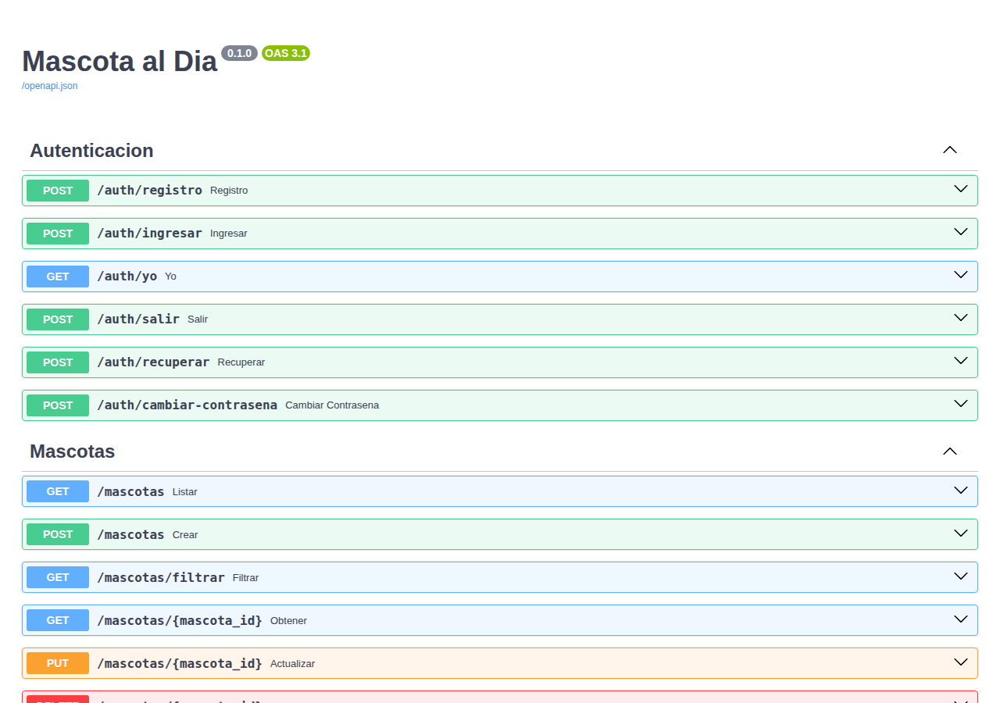
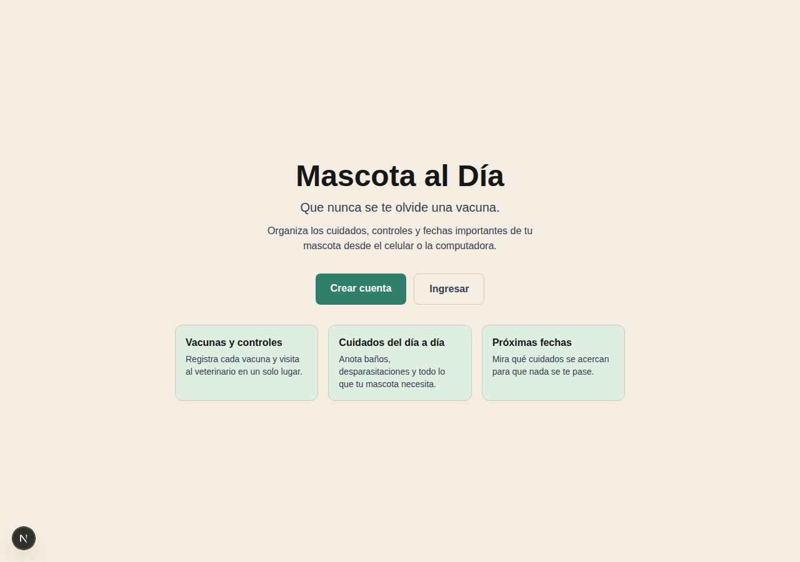
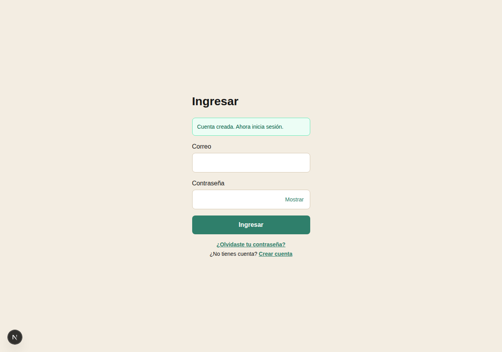
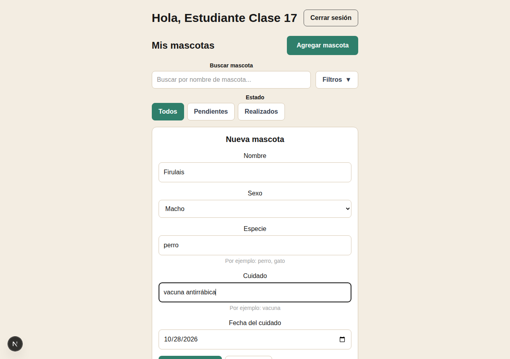
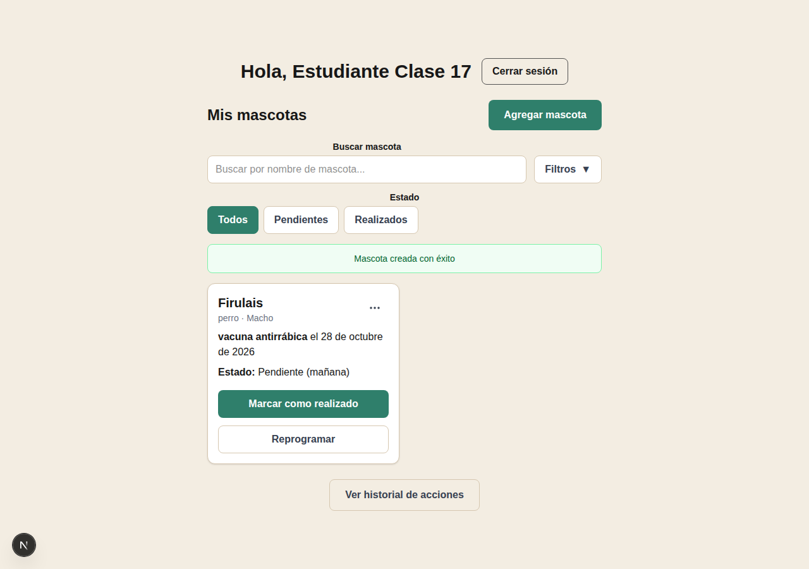
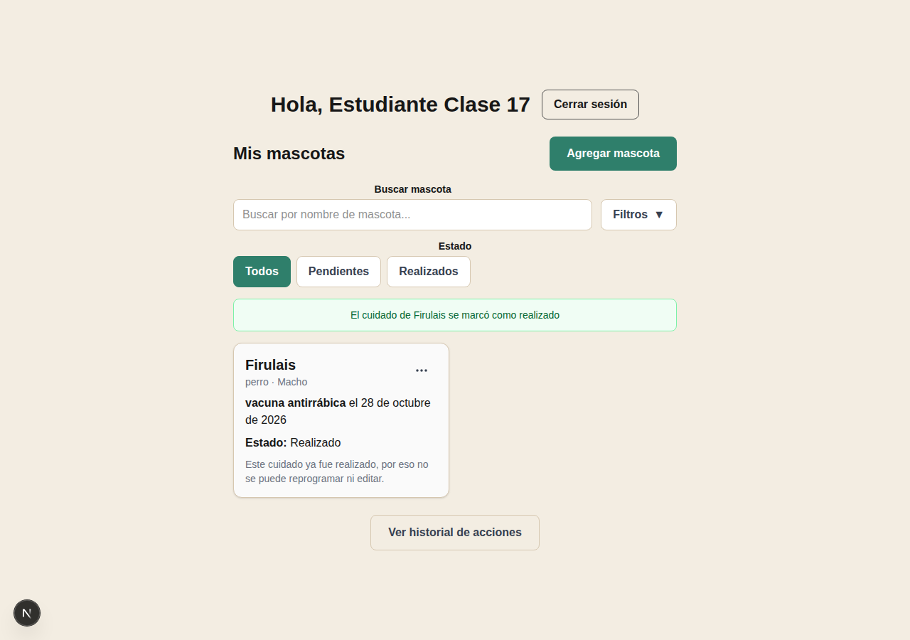
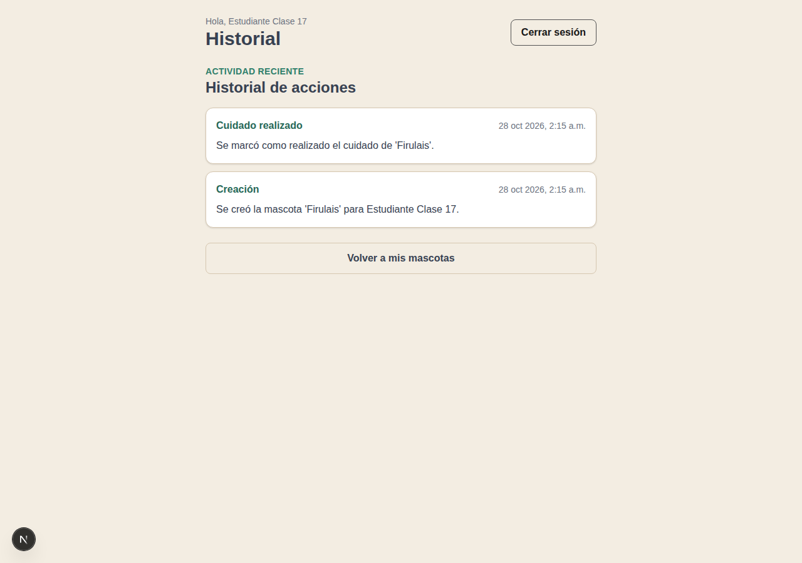

# Clase 17 · Código ajeno y refactoring

## Proyecto recibido

Proyecto analizado: **Mascota al Día** (Next.js + FastAPI + PostgreSQL/Neon), en el estado actual del repositorio de trabajo. Por indicación del curso, no se incluye aquí ningún enlace al repositorio ni al grupo de origen.

Funcionalidad principal ya implementada:

- Registro, ingreso y recuperación de contraseña de usuarios.
- Registro de mascotas con un "cuidado" (nombre, especie, tipo de cuidado y fecha).
- Marcar un cuidado como realizado y reprogramar su fecha.
- Historial de acciones (crear, actualizar, eliminar, reprogramar, realizar) por usuario.
- Filtros de mascotas por nombre, estado, tipo de cuidado y rango de fechas.

## Ejecución

El entorno virtual del backend y la instalación de dependencias (`pip install -r requirements.txt`) ya estaban hechos previamente. Para esta clase faltaba configurar una base de datos, así que se usó SQLite de forma local únicamente para poder levantar el proyecto y probar el recorrido (no se tocó Neon/Postgres de producción):

- `backend/.env` → `URL_BASE_DATOS = sqlite:///./local_clase17.db` (+ `SECRETO_JWT`, `MINUTOS_SESION`, `MINUTOS_CODIGO_RECUPERACION` con valores de prueba).
- `frontend/.env` → `URL_BASE = http://127.0.0.1:8000`.

Ambos archivos `.env` están ignorados por git (`backend/.gitignore`, `frontend/.gitignore`), así que no se suben al commit.

**Comandos utilizados:**

```bash
# backend (desde backend/, con el venv ya activado)
fastapi dev app/main.py
```

```bash
# frontend (desde frontend/, con Node 20+)
npm install
npm run dev
```

**Backend funcionando** (`/docs` de FastAPI, muestra las rutas de `auth` y `mascotas`):



**Frontend funcionando** (pantalla de inicio en `http://localhost:3000`):



## Recorrido: pantalla → acción → regla → datos

Se siguió el flujo real de **"marcar un cuidado como realizado"**, que es el más cercano a lo que pide la Tarea 5 para este proyecto (*"Mascota al Día: asignar un responsable a un cuidado y permitir marcarlo como realizado"*).

| Parte | Qué buscamos | Archivo real |
|---|---|---|
| Pantalla | Dónde se muestra el cuidado y el botón de acción | [`frontend/componentes/TarjetaMascota.tsx`](../frontend/componentes/TarjetaMascota.tsx) (botón "Marcar como realizado"), renderizada desde [`frontend/componentes/PanelMascota.tsx`](../frontend/componentes/PanelMascota.tsx) |
| Acción | Qué función responde al clic | `realizar(mascota)` en `PanelMascota.tsx:125` → llama a `marcarRealizado(mascota.id)` en [`frontend/lib/api.ts:163`](../frontend/lib/api.ts) → `PATCH /mascotas/{id}/realizar` |
| Regla | Dónde se valida la operación | `realizar()` en [`backend/app/routers/mascota.py:40`](../backend/app/routers/mascota.py) → `marcar_realizado()` en [`backend/app/services/mascota_servicio.py:64`](../backend/app/services/mascota_servicio.py) (valida dueño y que no esté ya realizado) |
| Datos | Dónde se guarda el resultado | `cambiar_estado()` en [`backend/app/repositories/mascota_repositorio.py:72`](../backend/app/repositories/mascota_repositorio.py) actualiza `Mascota.estado` en la tabla `mascotas`; además `historial_servicio.registrar()` inserta una fila en la tabla `historial` ([`backend/app/models/historial.py`](../backend/app/models/historial.py)) |

Prueba funcionando de principio a fin (registro → login → crear cuidado → marcarlo como realizado → verlo en el historial, y persiste al recargar porque vive en la base de datos):











## Impacto: qué deberá cambiar para la Tarea 5

La Tarea 5 pide **agregar una relación que antes no existía**: para "Mascota al Día", asignar un **responsable** a un cuidado (distinto del dueño que lo creó) y que ese cuidado se pueda marcar como realizado.

Hoy `Mascota` (en [`backend/app/models/mascota.py`](../backend/app/models/mascota.py)) solo tiene `usuario_id`, que es el dueño/creador — no existe ningún concepto de "responsable asignado". Para incorporar esa relación nueva habría que tocar:

- **Modelo** (`backend/app/models/mascota.py`): agregar `responsable_id` como `ForeignKey("usuarios.id")` (nullable, porque no todo cuidado tendría responsable asignado) y la relación `responsable = relationship("Usuario", foreign_keys=[responsable_id])`.
- **Modelo** (`backend/app/models/usuario.py`): agregar la relación inversa, por ejemplo `cuidados_asignados = relationship("Mascota", foreign_keys="Mascota.responsable_id")`.
- **Esquemas** (`backend/app/schemas/mascota.py`): nuevo esquema de entrada para asignar responsable (`responsable_id` o el correo del responsable) y agregar el dato a `MascotaSalida` para que el frontend lo pueda mostrar.
- **Repositorio** (`backend/app/repositories/mascota_repositorio.py`): nueva función `asignar_responsable(session, mascota, responsable_id)`, siguiendo el mismo patrón que `cambiar_estado()`.
- **Servicio** (`backend/app/services/mascota_servicio.py`): nueva función `asignar_responsable(...)` que valide que el usuario responsable exista (reutilizando `repo_usuario.buscar_por_id`) y registre un nuevo tipo de evento en el historial (por ejemplo `"asignar_responsable"`).
- **Router** (`backend/app/routers/mascota.py`): nuevo endpoint, por ejemplo `PATCH /mascotas/{mascota_id}/responsable`.
- **Frontend** (`frontend/lib/api.ts`, tipo `Mascota`): agregar `responsableId`/`responsableNombre` y una función `asignarResponsable(id, responsableId)`.
- **Frontend UI** (`frontend/componentes/TarjetaMascota.tsx` / `PanelMascota.tsx`): mostrar el responsable asignado y un control para elegirlo; esto a su vez necesitaría un endpoint para listar/buscar usuarios, que hoy no existe (solo existe `GET /auth/yo` para el usuario logueado).
- Posible regla adicional: decidir si `marcar_realizado()` debe permitir que lo marque también el responsable asignado y no solo el dueño.

Como el estado y el historial ya viven en la base de datos (no en memoria ni en el estado de React), el mismo patrón de persistencia que usa `estado` en `mascotas` aplicaría igual para `responsable_id`: el dato sobrevive a recargar la página o volver a entrar.
