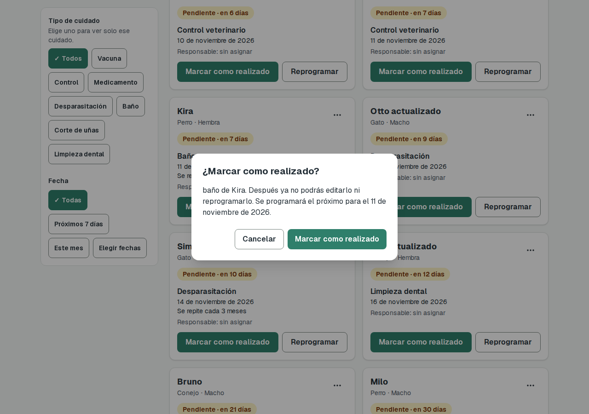
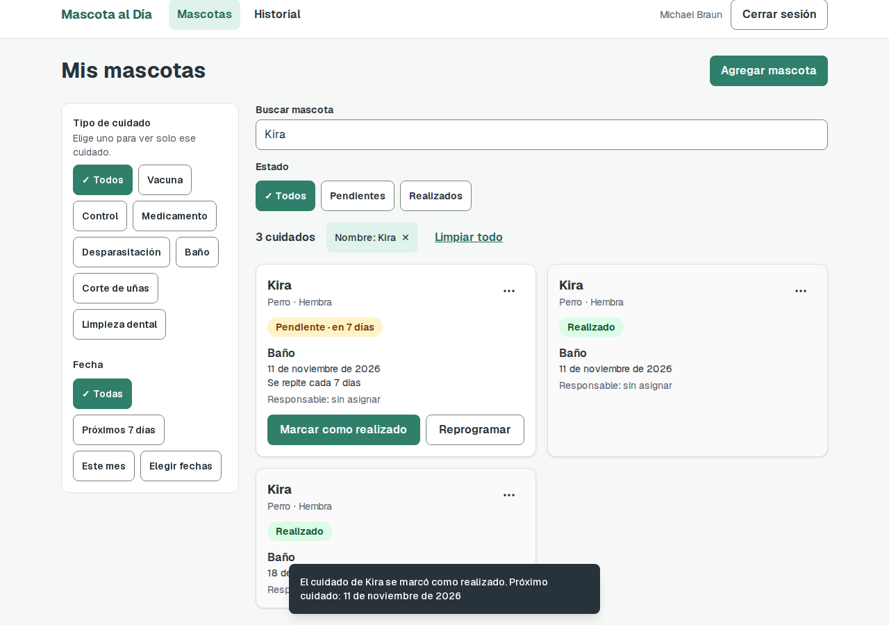
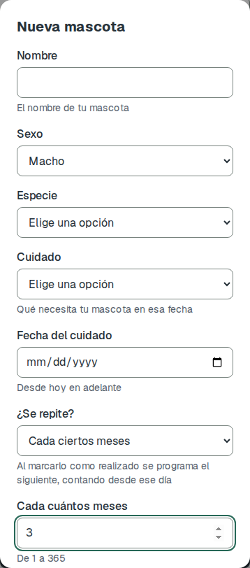
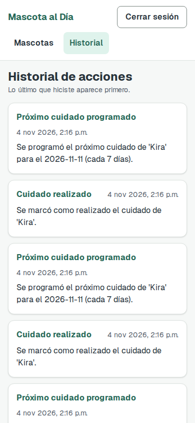

# Tarea 6: pruebas E2E y cuidados recurrentes

Clase 18, *Pruebas E2E y experiencia del usuario*. Proyecto: **Mascota al Día**.

## Resumen

| | Antes de la feature | Después de la feature |
|---|---|---|
| Pruebas E2E (Chromium + Firefox) | 70 de 70 pasan | 86 de 86 pasan |
| Pruebas E2E por navegador | 35 | 43 |
| Pruebas de backend (`pytest`) | 29 de 29 pasan | 58 de 58 pasan |
| Salida completa | [suite-antes.txt](tarea-6/suite-antes.txt) | [suite-despues.txt](tarea-6/suite-despues.txt) |

Las 35 pruebas de "antes" siguen pasando después de la feature, incluidas las 3 capturas visuales sin actualizar. Repetir la suite 3 veces en Chromium dio 129 de 129, sin pruebas inestables.

**WebKit no se ejecutó.** El navegador no arranca en el equipo de desarrollo porque faltan librerías del sistema. Para probarlo: `sudo pnpm exec playwright install-deps webkit`.

Las pruebas corrieron contra un PostgreSQL 16 local y desechable, no contra la base de Neon.

## Feature: cuidados recurrentes

| Regla pedida | Cómo quedó |
|---|---|
| Cada N días | Cada N días, meses o años (N de 1 a 365). "Cada año" cae el mismo día del año siguiente. |
| Al marcarlo realizado se calcula la próxima fecha | Se crea un cuidado pendiente con la fecha `día en que se marcó + intervalo`. El anterior queda realizado. |
| El historial guarda cada vez | Cada ciclo registra "Cuidado realizado" y "Próximo cuidado programado", con la fecha y la frecuencia. |
| La prueba comprueba que aparece la próxima fecha correcta | Se ve en la confirmación, en el mensaje de éxito y en la tarjeta nueva, y sigue ahí al recargar. |

### Decisiones

- **Se cuenta desde el día en que se marca**, no desde la fecha programada, para que la próxima fecha nunca quede en el pasado. Si se marca antes de tiempo, la próxima fecha puede caer antes de la que estaba programada.
- **Fin de mes:** 31 de enero + 1 mes = 28 de febrero; 29 de febrero + 1 año = 28 de febrero.
- **Detener la serie:** editar a "No se repite" o eliminar el cuidado pendiente. Al eliminar, la confirmación avisa que dejará de repetirse.

### Capturas

| Confirmación con la próxima fecha | Tarjeta nueva y mensaje de éxito |
|---|---|
|  |  |

| Formulario en celular | Historial en celular |
|---|---|
|  |  |

## Matriz de pruebas

"Antes" y "Después" indican si la prueba pasa en cada corrida. "—" significa que la prueba aún no existía.

### Flujos

| Flujo | Tipo | Prueba | Qué comprueba en pantalla | Antes | Después |
|---|---|---|---|---|---|
| Registro | Feliz | Ana crea su cuenta e ingresa | Mensaje "Cuenta creada" y llega a Mis mascotas | ✅ | ✅ |
| Registro | Alternativo | Ana no puede registrar un correo que ya existe | Alerta de error y sigue en `/registro` | ✅ | ✅ |
| Ingreso | Alternativo | Ana ve un error si su contraseña es incorrecta | Alerta de error y sigue en `/ingresar` | ✅ | ✅ |
| Recuperar contraseña | Feliz | Ana recupera su contraseña con el código | "Contraseña actualizada" e ingresa con la nueva | ✅ | ✅ |
| Recuperar contraseña | Alternativo | Ana ve un error si escribe un código equivocado | Alerta de error | ✅ | ✅ |
| Salir | Feliz | Ana cierra sesión y ya no puede volver a su lista | Vuelve a `/ingresar`, también al abrir `/inicio` | ✅ | ✅ |
| Permiso | Alternativo | Sin sesión, `/inicio` lleva al login | Redirige a `/ingresar` | ✅ | ✅ |
| Permiso | Alternativo | Sin sesión, `/historial` lleva al login | Redirige a `/ingresar` | ✅ | ✅ |
| Crear (flujo principal) | Feliz | Ana registra una mascota y la ve en su lista | Mensaje de éxito y la mascota sigue al recargar | ✅ | ✅ |
| Crear | Alternativo | Ana ve qué corregir si envía el formulario vacío | Lista vacía y mensaje de error por campo | ✅ | ✅ |
| Crear | Alternativo | Ana no puede crear un cuidado con fecha pasada | "La fecha no puede ser anterior a hoy" | ✅ | ✅ |
| Filtrar | Feliz | Ana filtra por tipo de cuidado y limpia los filtros | El conteo y las tarjetas cambian | ✅ | ✅ |
| Filtrar | Alternativo | Ana usa un filtro sin resultados y ve el aviso | "Ningún cuidado coincide con los filtros." | ✅ | ✅ |
| Editar | Feliz | Ana edita los datos de un cuidado | Mensaje de éxito y nombre nuevo | ✅ | ✅ |
| Editar | Alternativo | Ana no puede dejar el nombre vacío al editar | Error en el campo | ✅ | ✅ |
| Reprogramar | Feliz | Ana reprograma un cuidado | Fecha nueva y "Pendiente · en 10 días" | ✅ | ✅ |
| Reprogramar | Alternativo | Ana no puede reprogramar a una fecha pasada | "La fecha no puede ser anterior a hoy" | ✅ | ✅ |
| Responsable | Feliz | Ana asigna a otra persona como responsable | "Responsable: Juan Responsable" en la tarjeta | ✅ | ✅ |
| Responsable | Alternativo | Ana ve un error si el responsable no tiene cuenta | "No existe una cuenta con ese correo" | ✅ | ✅ |
| Realizar | Feliz | Ana marca un cuidado como realizado y sigue así al recargar | Estado "Realizado", sin acciones de cambio | ✅ | ✅ |
| Realizar | Alternativo | Ana cancela al marcar como realizado | Sigue "Pendiente · hoy" | ✅ | ✅ |
| Eliminar | Feliz | Ana elimina un cuidado y no vuelve al recargar | Mensaje de éxito y lista vacía | ✅ | ✅ |
| Eliminar | Alternativo | Ana cancela al eliminar | El cuidado sigue en la lista | ✅ | ✅ |
| Historial | Feliz | Ana ve en el historial lo que hizo | Registros en orden, lo último primero | ✅ | ✅ |
| Historial | Alternativo | Una cuenta nueva ve el historial vacío | "Todavía no hay acciones registradas." | ✅ | ✅ |

### Cuidados recurrentes

| Tipo | Prueba | Qué comprueba en pantalla | Antes | Después |
|---|---|---|---|---|
| Feliz | Ana realiza un baño cada 7 días y aparece la próxima fecha correcta | Fecha en la confirmación, en el mensaje y en la tarjeta nueva; persiste al recargar | — | ✅ |
| Feliz | Una vacuna cada año vuelve el mismo día del año siguiente | Fecha correcta en la tarjeta pendiente | — | ✅ |
| Feliz | El historial guarda cada vez que se realiza | 2 ciclos: 2 "Cuidado realizado" y 2 "Próximo cuidado programado" | — | ✅ |
| Alternativo | Ana no puede guardar una repetición de 0 días | "Escribe un número entero de 1 a 365"; no se crea nada | — | ✅ |
| Alternativo | Un cuidado que no se repite no genera otra tarjeta | Sigue habiendo una sola tarjeta | — | ✅ |
| Alternativo | Ana edita un cuidado a "No se repite" y la serie se detiene | Una sola tarjeta tras marcarlo realizado | — | ✅ |
| Alternativo | Al eliminar un cuidado recurrente se avisa | "Dejará de repetirse" en la confirmación | — | ✅ |
| Accesibilidad | El formulario con repetición no tiene fallas | `axe` sin fallas, con el error visible | — | ✅ |

### Experiencia del usuario

| Concepto de la clase | Prueba | Cómo se comprueba | Antes | Después |
|---|---|---|---|---|
| Accesibilidad | `/ingresar`, `/registro`, `/recuperar` (3 pruebas) | `axe` sin fallas WCAG 2 A y AA | ✅ | ✅ |
| Accesibilidad | La lista y el historial | `axe` sin fallas | ✅ | ✅ |
| Accesibilidad | El formulario abierto, con errores visibles | `axe` sin fallas | ✅ | ✅ |
| Fitts | Los botones de una tarjeta miden al menos 44 px | `boundingBox()` | ✅ | ✅ |
| Regla de 3 toques | Marcar como realizado toma menos de 3 toques | Se cuentan los toques: 2 | ✅ | ✅ |
| Consistencia (H4) | Ingreso, registro y lista vacía (3 pruebas) | `toHaveScreenshot()` | ✅ | ✅ |

### Criterios de "qué comprobar"

| Criterio | Dónde se cubre |
|---|---|
| Éxito: mensaje y dato nuevo | Crear, editar, reprogramar, realizar, eliminar y recurrentes |
| Error: qué corregir | Formulario vacío, fecha pasada, contraseña, código, responsable, repetición de 0 días |
| Persistencia: sigue al recargar | Crear, realizar, eliminar y recurrentes |
| Vacío: mensaje y acción | Lista vacía, filtro sin resultados, historial vacío |
| Permiso: sin sesión, al login | `/inicio`, `/historial` y después de cerrar sesión |
| Relación: el otro usuario lo ve | **Parcial.** Asignar un responsable no le da acceso al cuidado, por regla del proyecto. Se comprueba que su nombre aparece en la tarjeta. |

## Cómo ejecutar

Frontend, backend y base de datos deben estar corriendo. Si la base ya tiene datos, primero hay que agregar las columnas nuevas, porque el proyecto no usa migraciones:

```sql
ALTER TABLE mascotas
  ADD COLUMN intervalo_cantidad INTEGER,
  ADD COLUMN intervalo_unidad VARCHAR(10);
```

```bash
pnpm exec playwright test --project=chromium --project=firefox   # suite E2E
cd backend && pytest                                             # pruebas de backend
```
