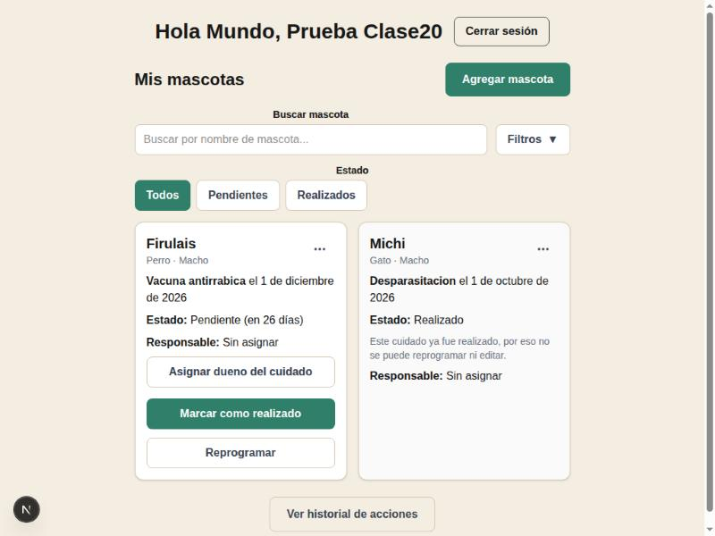
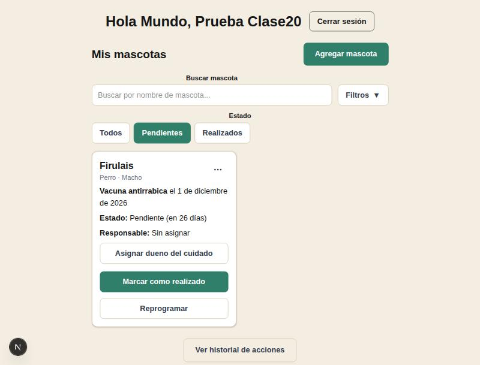

# Clase 20 · Prueba de usuario y mejora de usabilidad

- **Integrantes:** Alex Ticlla Choque y Gabriel Antony Choque Benavides
- **Proyecto:** Mascota al Día
- **Fecha:** 5 de noviembre de 2026

## Consigna

Un integrante del equipo prueba la app como si fuera un usuario nuevo, mientras el otro observa. A partir de esa prueba se identifica **una sola mejora pequeña** de usabilidad y se implementa.

## Prueba realizada

Uno de los integrantes creó una cuenta nueva, agregó dos mascotas con cuidados (uno pendiente y uno ya realizado) y navegó la pantalla principal ("Mis mascotas") mientras el otro observaba.

## Hallazgo

Al entrar a la pantalla principal, el filtro de **Estado** empezaba en **"Todos"**: la primera lista que ve el usuario mezcla cuidados pendientes con cuidados ya realizados. Lo que de verdad importa al abrir la app —qué falta por hacer— queda revuelto entre tarjetas que ya no requieren ninguna acción.

## Mejora implementada

Se cambió el valor inicial del filtro de Estado para que la pantalla cargue mostrando solo **"Pendientes"** por defecto. El usuario sigue pudiendo tocar "Todos" o "Realizados" cuando quiera verlos; solo cambia lo que se muestra al entrar.

**Antes** (por defecto se mostraban todos los cuidados, mezclados):

**Después** (por defecto se muestran solo los cuidados pendientes):

## Cambio en el código

Archivos modificados:

- [`frontend/lib/filtros.ts`](../frontend/lib/filtros.ts): se agregó `FILTROS_INICIALES`, igual a `FILTROS_VACIOS` pero con `estado: "pendiente"`. `FILTROS_VACIOS` no se tocó, así que el botón "Limpiar filtros" sigue quitando todos los filtros tal como antes.
- [`frontend/componentes/PanelMascota.tsx`](../frontend/componentes/PanelMascota.tsx): el estado inicial de filtros (`useState`) ahora usa `FILTROS_INICIALES` en vez de `FILTROS_VACIOS`.

En total son 2 archivos y menos de 10 líneas agregadas; no se tocó el backend ni el modelo de datos.

## Cómo probarlo

1. Levantar backend (`fastapi dev app/main.py`) y frontend (`npm run dev`).
2. Iniciar sesión con una cuenta que tenga cuidados pendientes y realizados.
3. Entrar a "Mis mascotas": el botón "Pendientes" debe aparecer ya seleccionado y solo deben listarse los cuidados que faltan.
4. Tocar "Todos" para confirmar que los cuidados realizados se siguen pudiendo ver.
