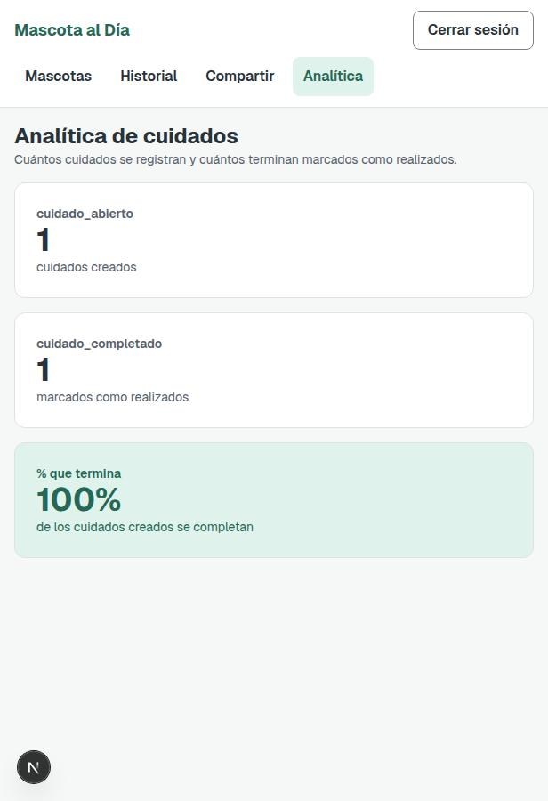

# Clase 21 · Analítica de interacción

- **Integrantes:** Alex Ticlla Choque y Gabriel Antony Choque Benavides
- **Proyecto:** Mascota al Día
- **Fecha:** 10 de noviembre de 2026

## Consigna (trabajo en clase, con nota)

Definir dos eventos del flujo principal de la app —uno de **inicio** y uno de **éxito**—, dispararlos con `track()` desde el código, guardarlos en una tabla `eventos` y mostrarlos en un panel propio en `/analitica` con cuántos hay de cada uno y el % que termina el flujo. Una prueba por evento.

Para **Mascota al Día** los eventos propuestos por la cátedra son:

| Evento de inicio | Evento de éxito |
|---|---|
| `cuidado_abierto` | `cuidado_completado` |

## Lo que ya existía (avance del compañero, commit `07841ee`)

- `backend/app/models/evento.py`: tabla `eventos` (`evento`, `props`, `flujo_id`, `fecha`). Sin datos personales: solo el nombre del evento, sus propiedades mínimas y un identificador de flujo.
- `backend/app/schemas/evento.py` y `backend/app/routers/analitica.py`: `POST /analitica/eventos` para guardar, `GET /analitica/resumen` que cuenta `flujo_id` distintos de `cuidado_abierto` y cuántos de esos mismos `flujo_id` llegaron a `cuidado_completado`.

Faltaba: nadie llamaba a `track()` desde el frontend (ningún evento se estaba generando) y no existía el panel `/analitica` para verlos.

## Lo que se agregó hoy

### 1. Disparar los eventos desde el código

- [`frontend/lib/api.ts`](../frontend/lib/api.ts): `registrarEvento()` (POST a `/analitica/eventos`, nunca rompe el flujo real si falla) y `flujoIdDeCuidado(id)`, que arma un UUID determinístico a partir del id de la mascota para que el evento de inicio y el de éxito del mismo cuidado compartan `flujo_id`.
- [`frontend/componentes/FormularioMascota.tsx`](../frontend/componentes/FormularioMascota.tsx): al crear una mascota (no al editar) se dispara `cuidado_abierto`.
- [`frontend/componentes/PanelMascota.tsx`](../frontend/componentes/PanelMascota.tsx): al confirmar "Marcar como realizado" se dispara `cuidado_completado`, con el mismo `flujo_id` que el de apertura.

### 2. Panel propio en `/analitica`

- [`frontend/componentes/PanelAnalitica.tsx`](../frontend/componentes/PanelAnalitica.tsx) (nuevo) + [`frontend/app/analitica/page.tsx`](../frontend/app/analitica/page.tsx) (nuevo): lee `GET /analitica/resumen` y muestra tres números grandes: cuántos `cuidado_abierto`, cuántos `cuidado_completado` y el % que termina.
- [`frontend/componentes/BarraSuperior.tsx`](../frontend/componentes/BarraSuperior.tsx): enlace "Analítica" en la navegación.
- [`frontend/proxy.ts`](../frontend/proxy.ts): la ruta `/analitica` también exige sesión iniciada.

### 3. Una prueba por evento

- [`backend/tests/test_analitica.py`](../backend/tests/test_analitica.py) (nuevo): guarda un `cuidado_abierto`, guarda un `cuidado_completado`, y un tercero que arma dos flujos abiertos y solo completa uno para comprobar el cálculo del resumen (`2 iniciados, 1 completado, 50%`).
- [`tests/analitica.spec.ts`](../tests/analitica.spec.ts) (nuevo), E2E con Playwright:
  - "crear un cuidado registra `cuidado_abierto` y sube en el panel".
  - "marcar un cuidado como realizado registra `cuidado_completado` y sube en el panel".

Las dos miden el resumen antes y después de la acción (en vez de un valor fijo) porque `/analitica/resumen` es un conteo global de toda la app, no por usuario; así la prueba no depende de datos de otras corridas.

## Decisión de privacidad

Siguiendo "registren la acción, no a la persona": el evento solo guarda `recurrente` (si el cuidado se repite o no) además del nombre del evento, el `flujo_id` y la fecha. No viaja el nombre de la mascota, el tipo de cuidado, ni ningún dato que identifique a la persona o a su mascota.

## Cómo probarlo

1. Levantar backend (`fastapi dev app/main.py` dentro de `backend/`) y frontend (`npm run dev` dentro de `frontend/`).
2. Crear una cuenta y una mascota con un cuidado para hoy.
3. Entrar a "Analítica": debe verse `cuidado_abierto: 1`.
4. Marcar el cuidado como realizado y volver a "Analítica": `cuidado_completado: 1` y `% que termina: 100%`.
5. Pruebas: `backend/.venv/bin/python -m pytest backend/tests/test_analitica.py -v` y `npx playwright test tests/analitica.spec.ts`.

## Fuera de alcance hoy

La tabla de la diapositiva 12/13 también define, para "Mascota al Día", una funcionalidad de **cuidados vencidos** (marcar un cuidado pendiente con fecha pasada como "vencido", registrar si se realizó tarde o se omitió con motivo). Esa es la parte de **funcionalidad** de la Tarea 9 (entrega jueves 12/11/2026, 18:00, con su propia E2E) y no se tocó en esta sesión: lo de hoy fue solo la parte de **analítica**.
