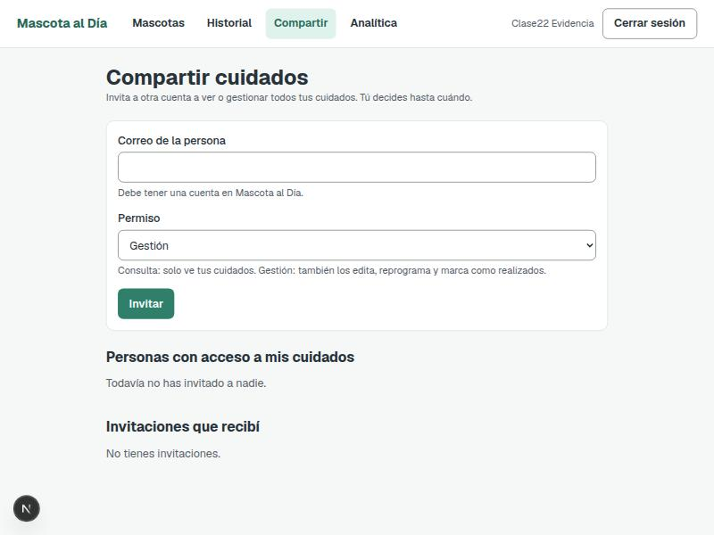
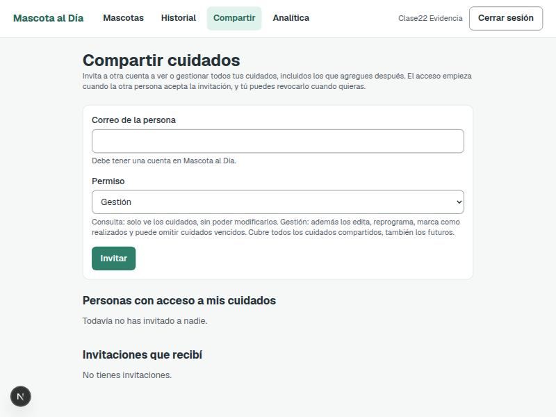

# Clase 22 · Patrones oscuros

- **Integrantes:** Alex Ticlla Choque y Gabriel Antony Choque Benavides
- **Proyecto:** Mascota al Día
- **Fecha:** 12 de noviembre de 2026
- **Modalidad:** con IA

## Consigna

Encontrar un patrón oscuro real en la app (de los seis vistos en clase), corregirlo con un
cambio mínimo, y probarlo con una prueba que falle antes y pase después.

## Hallazgo

Revisamos el formulario de "Compartir cuidados" (`/compartir`). **"Consulta" ya estaba bien
seleccionada por defecto** — ahí no había ningún patrón oscuro.

El problema real estaba en el texto de ayuda del campo **Permiso**: decía que "Gestión" permite
editar, reprogramar y marcar como realizado, pero **no mencionaba que Gestión también puede omitir
cuidados vencidos** (una capacidad real del backend, confirmada en
[`mascota_servicio.py`](../backend/app/services/mascota_servicio.py), función `omitir_cuidado`).
Tampoco quedaba claro que el acceso cubre **todos los cuidados compartidos, incluidos los
futuros** (confirmado en la misma función, vía `_con_permiso`), ni que la invitación necesita ser
aceptada antes de que el acceso sea efectivo.

Esto encaja con el patrón **"Permisos sin explicar"** (clase 22, patrón 6) y con el principio de
**consentimiento informado**: se le pide a alguien que otorgue un permiso sin decirle, con
suficiente claridad, todo lo que ese permiso implica.

- Archivo: [`frontend/componentes/PanelAccesos.tsx`](../frontend/componentes/PanelAccesos.tsx), línea 100 (antes del cambio).
- A quién beneficia: a nadie en particular, pero deja al invitado sin saber hasta dónde llega el acceso que está aceptando.

## Antes



```tsx
<p className="text-sm text-grisazulado">
  Invita a otra cuenta a ver o gestionar todos tus cuidados. Tú decides hasta cuándo.
</p>
...
ayuda="Consulta: solo ve tus cuidados. Gestión: también los edita, reprograma y marca como realizados."
```

## Después



```tsx
<p className="text-sm text-grisazulado">
  Invita a otra cuenta a ver o gestionar todos tus cuidados, incluidos los que agregues
  después. El acceso empieza cuando la otra persona acepta la invitación, y tú puedes
  revocarlo cuando quieras.
</p>
...
ayuda="Consulta: solo ve los cuidados, sin poder modificarlos. Gestión: además los edita, reprograma, marca como realizados y puede omitir cuidados vencidos. Cubre todos los cuidados compartidos, también los futuros."
```

Commit: `fix(etica): explicar alcance de permisos al compartir cuidados` (ver hash en el historial del repositorio).

## Prueba

- Archivo: [`tests/etica-permisos.spec.ts`](../tests/etica-permisos.spec.ts)
- Comando: `npx playwright test tests/etica-permisos.spec.ts --project=chromium`
- **Antes del cambio:** falló — el texto de ayuda no contenía "omitir cuidados vencidos".
- **Después del cambio:** pasó.
- Consulta sigue siendo el valor por defecto del selector (se verifica en la misma prueba).

### Regresión

- `npx tsc --noEmit` (frontend): sin errores.
- `pytest` (backend, 89 pruebas): todas pasan.
- `tests/acceso.spec.ts` (permisos de consulta/gestión): las 8 pruebas pasan sin cambios.
- `tests/cuidados-compartidos.spec.ts`: 2 pruebas fallan, pero por un problema preexistente al
  crear una mascota (`agregarMascota`) que ya ocurría antes de este cambio y que también afecta a
  `tests/flujo-principal.spec.ts` — no tiene relación con el formulario de Compartir ni con este
  patrón oscuro. Queda **pendiente**, fuera del alcance de esta tarea.

## Otros patrones revisados

No encontramos otro patrón oscuro claro en el flujo de compartir cuidados: las confirmaciones
("Revocar", "Aceptar"/"Rechazar") usan botones con el mismo peso visual y texto honesto, y no hay
urgencia ni culpa artificial en ningún mensaje.
