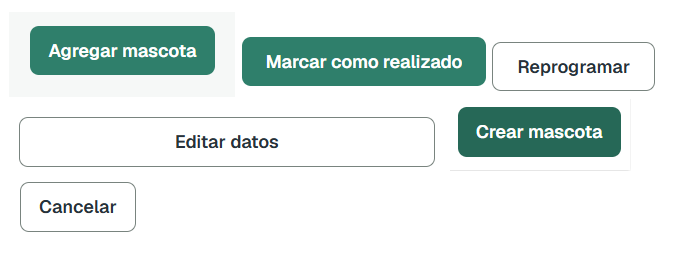
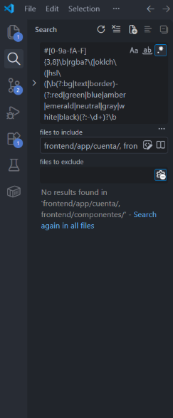

# Clase 23 — Del código al sistema: inventario de interfaz y tokens

## integrantes: Choque Benavides Gabriel Antony
##              Ticlla Choque Alex
## Modale : Sin IA
                

### 1. Inventario de botones — Mascota al Día

Se realizó un inventario visual de seis botones de la aplicación, correspondientes a las acciones Agregar mascota, Marcar como realizado, Reprogramar, Editar datos, Crear mascota y Cancelar.

**Diferencia 1 — Color y jerarquía:** Los botones principales presentan fondo verde y texto blanco, mientras que los secundarios utilizan fondo blanco con contorno. Esta diferencia es intencional y facilita la identificación de las acciones prioritarias.

**Diferencia 2 — Tamaño y distribución:** El botón «Editar datos» ocupa todo el ancho disponible de su contenedor, a diferencia de «Cancelar» y «Crear mascota», que presentan un ancho ajustado a su contenido. Esta variación responde a la distribución de los formularios y las tarjetas.

**Conclusión:** Se identificaron diferencias de presentación entre los botones. Las dos diferencias observadas responden a su función y ubicación, por lo que no se consideran errores de diseño. Se mantiene una jerarquía visual que distingue las acciones principales de las secundarias.

*Fuente: elaboración propia mediante capturas de Mascota al Día.*

### 2. Inventario de cinco tokens de diseño

Se identificaron cinco tokens semánticos en
`frontend/app/globals.css`, definidos mediante
el bloque `@theme inline`.

| Token | Valor claro | Valor oscuro | Uso |
|---|---|---|---|
| `--color-fondo` | `#F6F8F7` | No definido | Fondo general |
| `--color-menta-oscuro` | `#2F7F6B` | No definido | Botones principales |
| `--color-tinta` | `#27323A` | No definido | Texto principal |
| `--color-contorno` | `#79847F` | No definido | Bordes de controles |
| `--color-peligro` | `#C10007` | No definido | Errores y acciones peligrosas |

**Observación:** Los cinco tokens están implementados
en el tema actual. No se identificaron valores
alternativos para el modo oscuro en el archivo
CSS revisado.

**Fuente:** `frontend/app/globals.css`.

### 3. Conteo de colores fijos

**Pantalla evaluada:** Mi cuenta (`/cuenta`).

Se realizó una búsqueda en VS Code mediante expresiones
regulares para localizar colores escritos directamente
en los archivos de la interfaz.

| Elemento | Coincidencias |
|---|---:|
| Colores HEX, RGB y similares | 0 |
| Clases de colores directos de Tailwind | 0 |
| **Total** | **0** |

**Conclusión:** No se encontraron colores fijos que
coincidan con los patrones buscados. La interfaz utiliza
tokens semánticos definidos en `frontend/app/globals.css`,
lo que permite centralizar los colores y mantener
consistencia visual.