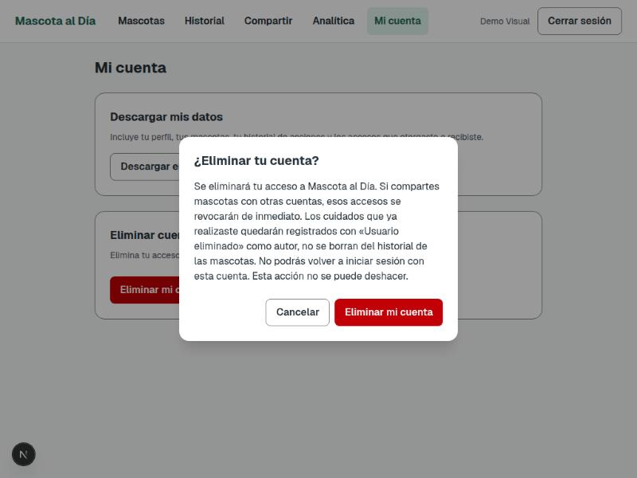

# Tarea 10 — Mis datos, eliminar cuenta y revisión de patrones oscuros

**Aplicación:** Mascota al Día
**Asignatura:** Interacción Humano-Computadora (IHC)
**Fecha de implementación:** 13 de noviembre de 2026
**Entorno probado:** FastAPI + Next.js + SQLite local + Playwright (Chromium/Linux)
**Rama:** `feat/tarea-10-eliminar-cuenta`, partiendo de `feat/permisos-no-patrones-oscuros`

## A. Mis datos (ver y descargar)

### Objetivo

Que cualquier persona pueda ver y descargar, en un formato que pueda abrir fuera de la
app, todos los datos que le pertenecen.

### Qué incluye el export

`GET /auth/mis-datos?formato=json|csv` (requiere sesión) devuelve:

- **Perfil**: id, nombre completo, correo, fecha de creación de la cuenta.
- **Mascotas propias**: incluye también las eliminadas lógicamente (`eliminada=true`),
  porque el derecho a los propios datos no depende de lo que ya no se muestra en la app.
- **Historial de acciones propias**: todo lo que la cuenta hizo (crear, editar, realizar,
  reprogramar, omitir, asignar responsable...), reutilizando `historial_servicio.listar_por_usuario`
  sin cambios.
- **Accesos que otorgó** y **accesos que recibió**, con su estado actual.

### Formato

Un solo endpoint con `?formato=json` (por defecto) o `?formato=csv`. Ambos responden con
`Content-Disposition: attachment` para forzar la descarga del archivo en vez de mostrarlo
en pantalla. La conversión a CSV vive en el backend (`cuenta_servicio.exportar_datos_csv`),
no en el frontend, para no duplicar la forma del dato en dos lenguajes.

### Dónde probarlo

- Backend: [`backend/tests/test_cuenta.py`](../backend/tests/test_cuenta.py) — `test_exportar_datos_incluye_perfil_mascotas_historial_y_accesos`, `test_exportar_datos_csv_incluye_las_secciones`.
- E2E: [`tests/cuenta.spec.ts`](../tests/cuenta.spec.ts) — `la pantalla de Mi cuenta ofrece descargar los datos propios`.
- Manual: entrar a **Mi cuenta**, botones "Descargar en JSON" / "Descargar en CSV".

## B. Eliminar cuenta

### Regla de negocio para Mascota al Día

> Si comparte mascotas, los accesos se revocan. Los cuidados realizados conservan
> «usuario eliminado» como autor.

La cuenta **no se borra de la base de datos: se anonimiza**. Esto es una decisión técnica,
no solo de producto: `Mascota.usuario_id`, `Mascota.realizado_por_id`, `Mascota.responsable_id`
y `Historial.usuario_id` son claves foráneas obligatorias sin `ondelete`, así que borrar la
fila dejaría referencias rotas. En su lugar, `DELETE /auth/cuenta` hace, en una sola
transacción:

1. **Revoca** todo `Acceso` donde la cuenta es propietaria o invitada, en estado
   `pendiente` o `aceptado` (igual que revocar uno a uno, solo que para todos a la vez).
2. **Anonimiza** la fila `Usuario`: `nombre_completo` pasa a `"Usuario eliminado"`, el
   correo se libera a una dirección interna no usable, la contraseña se reemplaza por un
   hash irrecuperable, y se limpia cualquier código de recuperación pendiente.

Como `Mascota.propietario_nombre`, `realizado_por_nombre`, `responsable_nombre` y
`Acceso.propietario_nombre`/`invitado_nombre` son propiedades que leen `nombre_completo`
en vivo desde esa misma fila, el cambio de nombre se propaga solo a todos esos lugares sin
tocar `Mascota`, `Historial` ni sus esquemas: es la pieza central del diseño.

La sesión es un JWT sin estado (sin tabla de sesiones), así que una cookie ya emitida
seguiría siendo válida hasta su expiración si no se revisara explícitamente. Por eso
`auth_servicio.usuario_desde_token` y `auth_servicio.autenticar` ahora rechazan a una
cuenta con `eliminado=True`, con estado `401`.

### Por qué no hay ningún caso que bloquee la eliminación

El enunciado pide que, si la regla bloquea la eliminación, el mensaje explique por qué y
qué hacer. En este dominio no existe ningún caso así: revocar accesos + anonimizar cubre
todo. No hay equivalente a "último administrador", saldo pendiente ni ninguna obligación
que dependa de que la cuenta siga activa. Las mascotas que la cuenta posee en solitario no
necesitan tratamiento especial: su fila `Usuario` sigue existiendo (anonimizada), así que
`Mascota.usuario_id` sigue siendo válida y `propietario_nombre` muestra "Usuario eliminado"
igual que el resto; nadie más puede verlas porque las consultas filtran por sesión, que es
exactamente el comportamiento esperado al eliminar la propia cuenta.

### Confirmación honesta

Reutiliza `DialogoConfirmar` tal cual (sin diálogo nuevo, sin pasos extra como reingresar
la contraseña o escribir "ELIMINAR"): mismo componente `Boton` para Cancelar y Confirmar,
mismo tamaño físico, sin redacción que induzca culpa.

> "Se eliminará tu acceso a Mascota al Día. Si compartes mascotas con otras cuentas, esos
> accesos se revocarán de inmediato. Los cuidados que ya realizaste quedarán registrados
> con «Usuario eliminado» como autor, no se borran del historial de las mascotas. No podrás
> volver a iniciar sesión con esta cuenta. Esta acción no se puede deshacer."

Tras confirmar, la sesión se cierra y se redirige a `/ingresar?cuenta=eliminada` con un
aviso honesto ("Tu cuenta fue eliminada. Los accesos compartidos quedaron revocados."),
igual que el aviso ya existente de sesión vencida — no una redirección silenciosa.

### Casos de prueba

| Caso | Dónde | Resultado |
|---|---|---|
| Revoca accesos otorgados y recibidos | `test_cuenta.py::test_eliminar_cuenta_revoca_los_accesos_que_otorgo_y_los_que_recibio` | Aprobado |
| Anonimiza el nombre, conserva la autoría | `test_cuenta.py::test_eliminar_cuenta_anonimiza_el_nombre_pero_conserva_la_autoria` | Aprobado |
| No se puede iniciar sesión tras eliminar | `test_cuenta.py::test_no_se_puede_iniciar_sesion_con_una_cuenta_eliminada` | Aprobado |
| Una cookie ya emitida deja de funcionar | `test_cuenta.py::test_una_cookie_ya_emitida_deja_de_funcionar_tras_eliminar_la_cuenta` | Aprobado |
| No se puede eliminar dos veces (idempotencia) | `test_cuenta.py::test_no_se_puede_eliminar_dos_veces` | Aprobado |
| Confirmación honesta, botones del mismo tamaño | `tests/cuenta.spec.ts` | Aprobado |
| Accesos revocados visibles para el invitado, sesión cerrada | `tests/cuenta.spec.ts` | Aprobado |
| Autor anonimizado visible para el propietario | `tests/cuenta.spec.ts` | Aprobado |

## C. Revisión de los seis patrones en toda la app

Se revisó, además de "Compartir" (ya cubierto en la clase 22), registro, ingreso/sesión
vencida, recuperar contraseña, inicio/mascotas, historial, analítica y la nueva pantalla
"Mi cuenta".

| Patrón | Dónde se revisó | Encontrado | Corregido / Pendiente |
|---|---|---|---|
| **Control y libertad** (Nielsen #3) | Recuperar contraseña, diálogos de confirmación, nueva pantalla "Mi cuenta" | Ya tenían salida clara ("Cambiar correo", "Cancelar", navegación siempre visible) | Nada que corregir |
| **Prevención de errores** (Nielsen #5) | `PanelMascota.tsx` (marcar realizado / eliminar), nueva confirmación de eliminar cuenta | Confirmaciones ya existentes siguen vigentes; se agregó una nueva para "Eliminar cuenta" | Corregido (agregado en esta tarea) |
| **Minimización de datos** | Eventos de analítica nuevos (`cuenta_eliminacion_iniciada`/`_exito`) | Sin `props` identificables, mismo criterio que `evidencias/clase-21.md` | Corregido (diseñado así desde el inicio) |
| **Privacidad por defecto** | `Historial.descripcion` (texto libre con nombres incrustados en el momento de la acción) | Es un registro de auditoría de un punto en el tiempo, no una referencia viva: reescribirlo retroactivamente rompería la auditoría | **Pendiente, documentado como limitación aceptada**: no se corrige en esta tarea |
| **Consentimiento informado** | Nueva pantalla "Mi cuenta" | El mensaje de eliminar cuenta explica explícitamente qué pasa con los accesos compartidos y con la autoría de los cuidados antes de pedir la confirmación | Corregido (caso principal que esta tarea agrega) |
| **Honestidad** | `FormularioRecuperar.tsx` (el endpoint `/auth/recuperar` devuelve el código en la respuesta HTTP, ya que no hay envío de correo real); `lib/api.ts` (`pedir()`) | El código de recuperación se muestra con una etiqueta explícita ("Simulación: como no se envía correo real..."), así que no es un patrón oscuro oculto, es una decisión de alcance del curso explicada en pantalla. Al revisar `pedir()` sí se encontró un problema real: un evento de analítica en segundo plano (disparado tras eliminar la cuenta) podía secuestrar la navegación hacia un aviso de "sesión vencida" en vez del aviso real, por un 401 que no debía interrumpir nada | **Recuperación: documentado, sin cambio** (implicaría un servidor de correo real, fuera de alcance). **`pedir()`: corregido** — commit `fix(etica): evitar que un evento de analítica en segundo plano interrumpa la navegación` |

## D. Analítica

Se amplió el mismo patrón de la Tarea 9: `EventoAnalitica` (frontend) y el `Literal` de
`EventoEntrada.evento` (backend) ahora aceptan `cuenta_eliminacion_iniciada` y
`cuenta_eliminacion_exito`. Se disparan desde `PanelCuenta.tsx`: el primero al abrir el
diálogo de confirmación, el segundo justo antes de redirigir a `/ingresar`, con un
`flujoId` propio (`crypto.randomUUID()`, no hay un id de mascota asociado) y sin ningún
dato identificable en `props`. `/analitica/resumen` no se tocó: sigue siendo específico al
embudo de cuidados; estos eventos quedan solo en la tabla `eventos` como evidencia
cualitativa.

## Decisiones de UX

- La confirmación de eliminar cuenta no pide reingresar la contraseña ni escribir una
  palabra de seguridad: el enunciado pide "sin pasos de más", y el texto ya explica con
  claridad las consecuencias.
- Tras eliminar, se cierra la sesión y se explica qué pasó en la pantalla de ingreso, en
  vez de dejar a la persona en un formulario vacío sin contexto.
- La descarga de datos usa enlaces `<a download>` reales, no la navegación de Next.js
  (se agregó la prop `descargar` a `Boton.tsx` para esto), porque una respuesta con
  `Content-Disposition: attachment` necesita que el navegador la maneje nativamente.

## Evidencias y reproducibilidad

| Evidencia | Resultado |
|---|---|
| Pruebas backend completas | `backend/.venv/bin/python -m pytest -q` → **96 passed** (89 previas + 7 nuevas de `test_cuenta.py`) |
| Pruebas backend de cuenta | `backend/.venv/bin/python -m pytest tests/test_cuenta.py -v` → **7 passed** |
| Tipos frontend | `npx tsc --noEmit` (desde `frontend/`) → sin errores |
| Lint frontend | `npm run lint` (desde `frontend/`) → 0 errores (1 warning preexistente, no relacionado, en `pedir()`) |
| E2E de Mi cuenta | `npx playwright test tests/cuenta.spec.ts --project=chromium` → **4 passed** |
| E2E completos (paralelo, con visuales) | `npx playwright test --project=chromium --reporter=line` → **59 passed, 2 skipped** |

### Dos fallos reales de E2E encontrados y corregidos (no de producción)

Al correr la suite completa aparecieron dos fallos deterministas, ninguno del código de
`backend/` o `frontend/`, ambos ya corregidos en commits propios:

1. **`tests/visual.spec.ts` — "La lista vacía se ve igual"**: el snapshot de referencia
   quedó desactualizado porque la barra de navegación ahora tiene el enlace "Mi cuenta"
   (sección B). Se regeneró con `--update-snapshots` (commit `test(visual): ...`).
2. **`tests/analitica.spec.ts` — "crear un cuidado registra cuidado_abierto..."**: una
   condición de carrera preexistente en la prueba, no en el producto. `registrarEvento()`
   se dispara a propósito en segundo plano (para no bloquear el flujo real de la persona),
   así que leer `/analitica/resumen` justo después de crear el cuidado a veces llegaba
   antes de que el evento se guardara; y como `/analitica/resumen` es un conteo **global**
   (documentado en `evidencias/clase-21.md`), comparar el panel contra un número capturado
   en un instante anterior fallaba si otra prueba en paralelo también creaba o completaba
   un cuidado mientras tanto. Se corrigió con `expect.poll` y leyendo el número actual del
   panel en vez de una variable congelada (commit `fix(e2e): ...`).

Tras el arreglo: `npx playwright test --project=chromium --reporter=line` (en paralelo) y
`--workers=1` corridos varias veces, **sin fallos relacionados con analítica ni visuales**.
Se observó, además, un fallo intermitente aislado en `cuidados.spec.ts` (no tocado por esta
tarea) al correr la suite completa bajo carga, que **pasa sin cambios al ejecutarse solo**
— consistente con la flakiness por carga ya documentada en `evidencias/clase-22.md`
("problema preexistente... fuera del alcance de esta tarea"), no una regresión.

### Demostración manual sugerida

1. Levantar backend (`fastapi dev app/main.py` en `backend/`) y frontend (`npm run dev` en `frontend/`).
2. Crear dos cuentas y compartir una mascota de la primera con la segunda (permiso gestión).
3. Con la segunda cuenta, marcar un cuidado como realizado.
4. Entrar a **Mi cuenta** con la segunda cuenta, descargar los datos (JSON y CSV) y revisar el contenido.
5. Eliminar la cuenta: ver el diálogo honesto, confirmar, y comprobar el aviso en `/ingresar`.
6. Con la primera cuenta, entrar a **Compartir** y comprobar que el acceso quedó "Revocado", y en **Inicio** (filtro "Realizados") que el cuidado muestra "Realizado por Usuario eliminado".
7. Intentar iniciar sesión con la cuenta eliminada: debe rechazarse.
