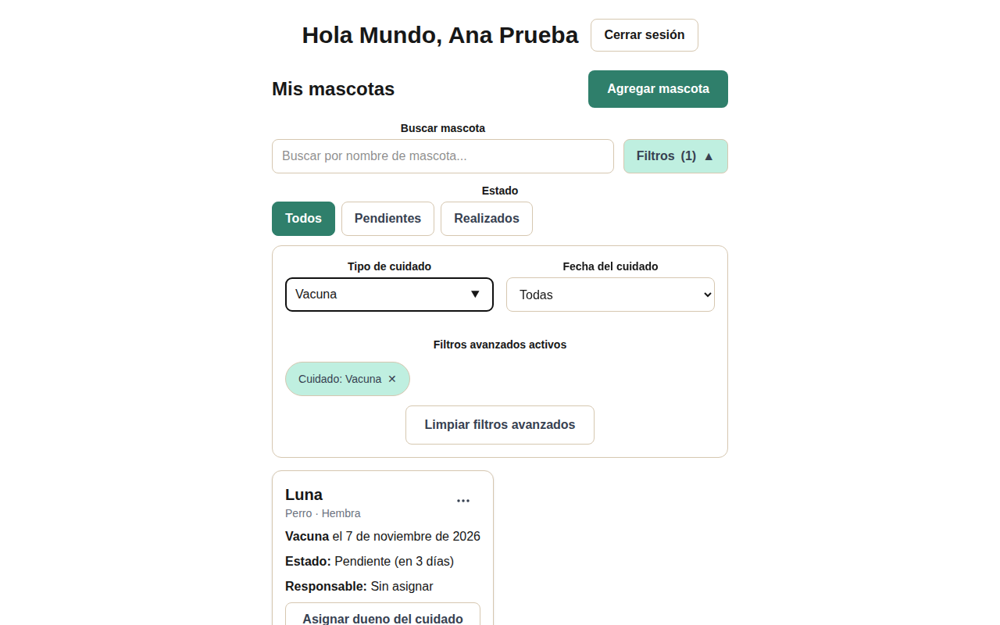
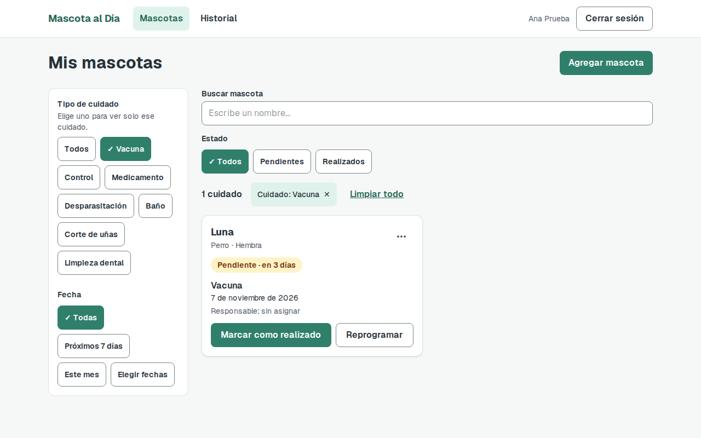
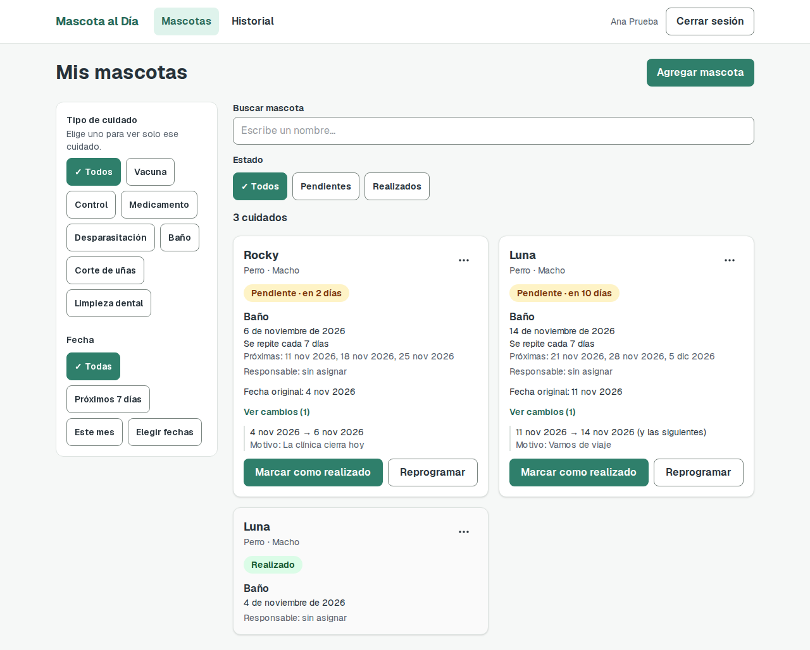
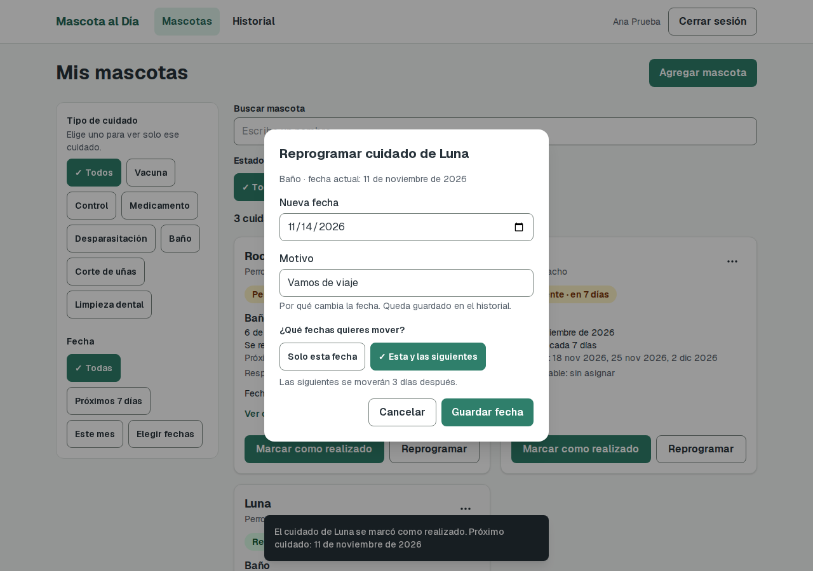
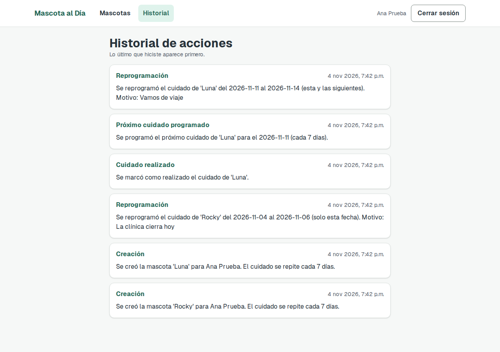
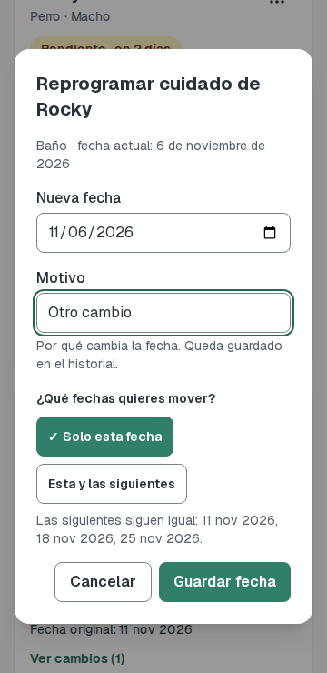

# Tarea 7: mejora por feedback y funcionalidad del caso

Clase 19, *Usabilidad y mejora del producto*. Proyecto: **Mascota al Día**.

**Feedback recibido:** [feedback de Adolfo Mendoza Ribera](https://github.com/ihc-team/Pre_estudiantil/blob/main/clase-19-feedback-a-otro-proyecto/mendoza-1-ribera-2/feedback.md)

## Commits

| Cambio | Commit | Mensaje |
|---|---|---|
| 1. Mejora por feedback | `2765dbc` | `fix: ordenar y guiar los filtros de la pantalla principal` |
| 2. Funcionalidad del caso | `c81c6d7` | `feat: reprogramar cuidado con motivo y alcance` |

Entre ambos está `c03813b` (`feat: cuidados recurrentes y suite E2E`). Es la entrega de la tarea 6, que aún no tenía commit y es la base de este cambio.

## 1. Mejora por feedback

**Observación del evaluador:** "La sección de filtros resulta confusa a la vista porque carece de textos o mensajes de guía". Completó la tarea con ayuda.

| Paso | Qué se hizo |
|---|---|
| Reproducir | En `a064df4`, se abre "Filtros" y se escribe en "Tipo de cuidado". No hay guía ni contador de resultados, y "Limpiar filtros avanzados" no quita los filtros de nombre o estado. |
| Definir la mejora | Mostrar las opciones con una ayuda, y mantener a la vista los resultados, los filtros activos y una sola forma de limpiarlos. |
| Localizar el código | `FiltrosMascotas.tsx`, `PanelMascota.tsx`; se agregan `BuscadorMascotas.tsx`, `ResumenFiltros.tsx`, `GrupoChips.tsx` y `Chip.tsx`. |
| Implementar | Columna fija de filtros (en celular, tras un botón), opciones visibles con ayuda, contador, filtros activos y "Limpiar todo". |
| Comprobar | Se repitió la tarea con los mismos datos y se automatizó en `flujo-principal.spec.ts`: 5 de 5 en Chromium. |

| Antes (`a064df4`) | Después (`2765dbc`) |
|---|---|
|  |  |

El mismo commit corrige otros puntos del feedback: fechas pasadas rechazadas al crear, especie y cuidado como listas con la opción "Otro", mejor uso del espacio y nueva paleta.

**No incluidos, por decisión del equipo:**
- **Campo para el problema de la mascota:** requiere otro dato en la base y no era el problema elegido.
- **Varias etiquetas del mismo tipo:** se mantiene una a la vez para que el filtro siga siendo simple.

**Límite:** la mejora se comprobó con pruebas y revisión propia. No se repitió con el evaluador, así que no demuestra que ahora se complete sin ayuda.

## 2. Funcionalidad: reprogramar una ocurrencia sin perder el historial

| Regla | Resultado |
|---|---|
| Reprogramar un pendiente con motivo | El motivo es obligatorio en el formulario y en el backend. Los realizados no se reprograman. |
| Conservar fecha original, nueva fecha y cambios anteriores | Cada cambio queda en la tabla `reprogramaciones`. La tarjeta muestra "Fecha original" y "Ver cambios"; el historial, fechas y motivo. |
| Si es recurrente, elegir el alcance | Opciones "Solo esta fecha" y "Esta y las siguientes", con un aviso de lo que pasará. Si no se repite, no se pregunta. |
| Desplazar las futuras la misma diferencia | Mover +3 días pasa las siguientes de 18, 25 nov y 2 dic a 21, 28 nov y 5 dic. |
| No alterar realizados ni generar duplicados | La tarjeta realizada no cambia y sigue habiendo una sola tarjeta pendiente, también al recargar. |

**Escenario mínimo en pantalla.** Rocky movió solo esta fecha y conserva las siguientes (11, 18 y 25 nov). Luna movió también las siguientes y su cuidado realizado no cambió.



| Formulario con aviso | Historial | Celular |
|---|---|---|
|  |  |  |

### Pruebas

| Suite | Antes de este cambio | Después |
|---|---|---|
| Backend (`pytest`) | 58 de 58 | 69 de 69 |
| E2E, Chromium y Firefox ([salida](tarea-7/suite-e2e.txt)) | 86 de 86 | 98 de 98 |
| `tests/reprogramar.spec.ts`, `acceso` y `recurrentes`, repetidas 3 veces | | 132 de 132 |

Las pruebas corrieron contra una base SQLite temporal, no contra Neon. **WebKit no se ejecutó:** al equipo le faltan dependencias del sistema.

### Decisiones y límites

- **Las futuras son fechas calculadas, no registros.** Cada serie guarda un pendiente; el siguiente se crea al marcarlo realizado, y las demás fechas se calculan desde `fecha_base`. Por eso no pueden duplicarse. Tampoco se puede mover una fecha lejana por separado: solo la pendiente actual, sola o con las siguientes.
- **Cambia una regla de la tarea 6.** La próxima fecha ya no se cuenta desde el día en que se marca, sino desde la base, porque si no ambas opciones darían el mismo resultado. Nunca cae en el pasado ni antes de la fecha movida. Marcar el mismo día de la fecha programada da igual que antes. Se actualizaron las pruebas de adelanto, retraso y reprogramación, y la de historial con dos ciclos.
- **Se corrigió una prueba inestable de la tarea 6.** En `acceso.spec.ts`, el selector de alerta a veces encontraba también el anunciador de rutas de Next. Falló una vez en Firefox.

### Base de datos existente

`create_all` crea la tabla `reprogramaciones`, pero no agrega columnas a tablas existentes. Falta ejecutar una vez, además del `ALTER` de la [tarea 6](../docs/evidencias/tarea-6.md):

```sql
ALTER TABLE mascotas ADD COLUMN fecha_base DATE;
```

Sin esa columna, las consultas de mascotas fallan. Se comprobó en una copia temporal con el esquema anterior; **no se ejecutó en Neon**.
