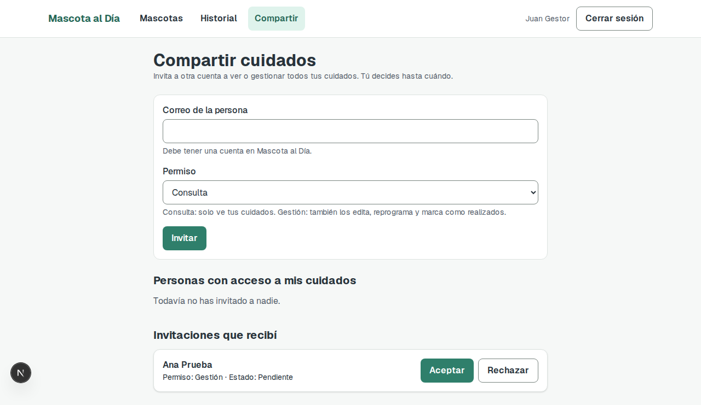
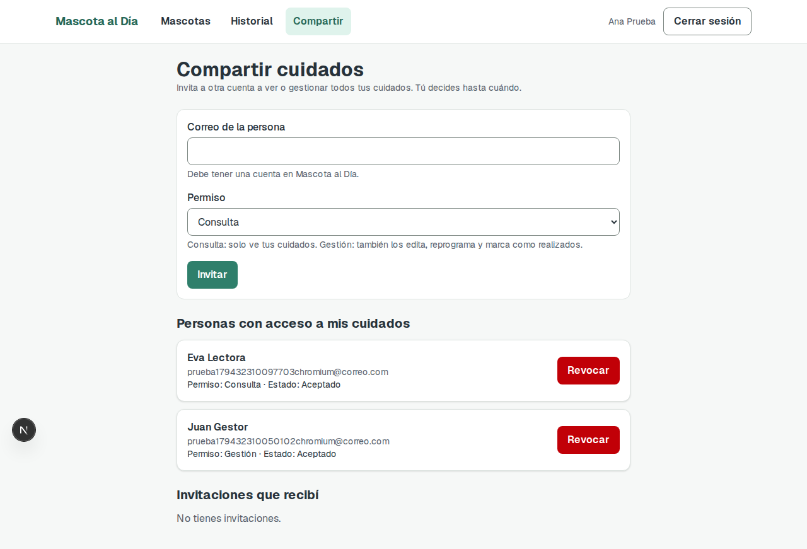
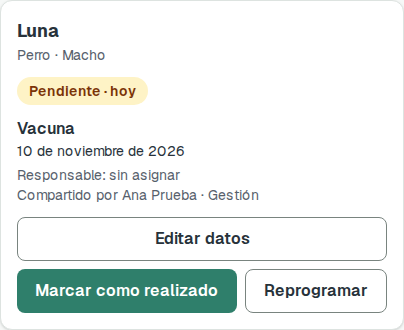
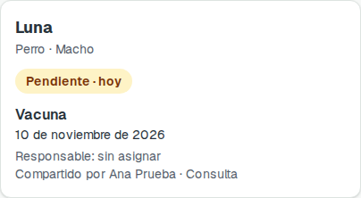
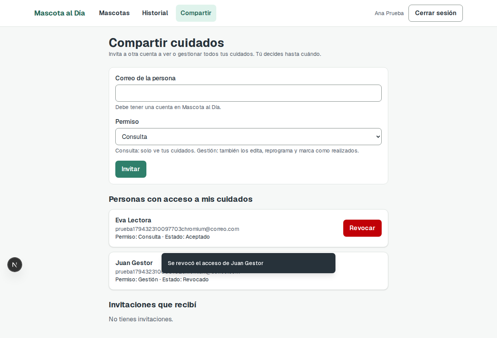
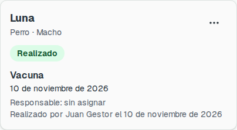

# Tarea 8: Cuidados compartidos

Clase 20, *Arquitectura de información*. Proyecto: **Mascota al Día**.

- **Integrantes:** Alex Ticlla Choque y Gabriel Antony Choque Benavides
- **Funcionalidad asignada:** Mascota al Día · Cuidados compartidos. El responsable invita a otra cuenta, que acepta o rechaza; asigna un permiso de consulta o de gestión y puede revocarlo; solo el responsable administra accesos; cada cuidado realizado conserva autor y fecha, incluso tras revocar el acceso.
- **Commit:** _se completa al hacer el commit_ (el cambio está en la rama `feat/cuidados-compartidos`).

## Funcionalidad

El propietario comparte **toda su lista de cuidados** con otra cuenta desde la nueva pantalla **Compartir** (`/compartir`).

| Regla | Resultado |
|---|---|
| Invitar | Correo de una cuenta existente y un permiso: **Consulta** o **Gestión**. Queda *pendiente* y no da acceso. |
| Aceptar o rechazar | Solo el invitado, y solo una vez. Al aceptar ve los cuidados del propietario en "Mascotas" con "Compartido por …". Al rechazar no ve nada y el propietario puede volver a invitarlo. |
| Permiso de consulta | Ve los cuidados. No tiene ningún botón de acción (la API responde 403 si lo intenta). |
| Permiso de gestión | Además edita, reprograma y marca como realizado. **No** elimina ni asigna responsable (404). |
| Revocar | Solo el propietario. El invitado deja de ver los cuidados en su siguiente consulta; la fila queda como *Revocado*, no se borra. |
| Solo el responsable administra | Invitar y revocar actúan siempre sobre la lista de quien hace la petición: un invitado que intenta revocar un acceso ajeno recibe 404. |
| Autor y fecha | Al marcar como realizado se guarda quién y cuándo. La tarjeta muestra "Realizado por Juan Gestor el 10 de noviembre de 2026" y se conserva tras revocar. |
| Sin duplicados | No se invita a una cuenta con invitación pendiente o aceptada (409), ni a uno mismo (400). |

### Pantallas

| Invitación recibida | Accesos con sus permisos |
|---|---|
|  |  |

| Tarjeta con gestión | Tarjeta con consulta |
|---|---|
|  |  |

| Acceso revocado | Realizado, tras revocar |
|---|---|
|  |  |

## Decisiones

- **Se comparte la lista completa, no cada cuidado.** Un cuidado recurrente crea una fila nueva cada vez que se marca como realizado; compartir por fila obligaría a copiar el acceso en cada una. Con el acceso a nivel de cuenta, la serie sigue visible sin hacer nada.
- **Una invitación es una fila de la tabla `accesos`** (`pendiente`, `aceptado`, `rechazado` o `revocado`). Nada se borra, así queda el rastro de lo que pasó.
- **Sin acceso es 404, con acceso insuficiente es 403.** Mantiene la regla de la tarea anterior de no revelar que un cuidado existe, y explica el motivo cuando la persona sí lo ve.
- **El siguiente cuidado de una serie sigue siendo del propietario** aunque lo haya realizado un invitado.
- **Para cambiar el permiso se revoca y se invita de nuevo.** Evita un endpoint más; el costo es un paso extra para el propietario.
- **Los accesos no se registran en "Historial"**, porque esa tabla exige una mascota. El estado de cada acceso se ve en la pantalla Compartir. Las acciones de un invitado sobre los cuidados sí quedan en su historial.

### Archivos afectados

| Parte | Archivos |
|---|---|
| Modelo | `backend/app/models/acceso.py` (nuevo), `models/mascota.py` (`realizado_por_id`, `realizado_en`) |
| Capas | `repositories/acceso_repositorio.py`, `services/acceso_servicio.py`, `routers/acceso.py`, `schemas/acceso.py` (nuevos); `services/mascota_servicio.py` (`_obtener_con_permiso`), `repositories/mascota_repositorio.py` (`_visibles`), `schemas/mascota.py`, `routers/mascota.py`, `main.py` |
| Pantallas | `frontend/app/compartir/page.tsx`, `componentes/PanelAccesos.tsx` (nuevos); `TarjetaMascota.tsx`, `BarraSuperior.tsx`, `lib/api.ts`, `proxy.ts` |
| Pruebas | `backend/tests/test_accesos.py`, `tests/cuidados-compartidos.spec.ts`, `tests/ayudantes.ts` (`abrirComo`, `compartirCon`), `tests/accesibilidad.spec.ts` |

Además se resolvieron los marcadores de conflicto de merge que había en `PanelMascota.tsx` y `.gitignore`: sin eso el frontend no compilaba.

## Pruebas

### E2E nuevas (`tests/cuidados-compartidos.spec.ts`)

Cada prueba crea sus propias cuentas con un texto único (no depende de datos previos) y cada persona usa su propio contexto de navegador.

1. **Recorrido completo, con tres actores.** Ana invita a Juan (gestión) y a Eva (consulta) → pendientes, sin acceso → ambos aceptan y el estado persiste al recargar → Juan ve el cuidado y puede actuar, pero sin menú de eliminar; Eva lo ve sin ningún botón → Juan lo marca como realizado → Ana revoca a Juan → Juan ya no lo ve → Eva y Ana siguen viendo "Realizado por Juan Gestor el …".
2. **Restricción: permisos y accesos.** Eva (consulta) recibe 403 al marcar como realizado; Juan (gestión) recibe 404 al eliminar y 404 al revocar el acceso de Eva; nada cambió al recargar; invitar dos veces a la misma cuenta y a uno mismo muestran su error.
3. Además, `accesibilidad.spec.ts` revisa con axe la pantalla Compartir.

### Cómo correrlas

Con el backend (`fastapi dev app/main.py` en `backend/`) y el frontend (`npm run dev` en `frontend/`) ya levantados, desde la raíz:

```bash
pnpm exec playwright test tests/cuidados-compartidos.spec.ts --project=chromium
pnpm exec playwright test --project=chromium --project=firefox      # la suite completa
cd backend && pytest                                                # backend
```

### Resultado

| Suite | Resultado |
|---|---|
| Backend (`pytest`) | **78 de 78** (69 anteriores + 9 de accesos) |
| E2E nuevas, Chromium y Firefox, 3 repeticiones | **12 de 12** |
| E2E completa, Chromium y Firefox ([salida](tarea-8/suite-e2e.txt)) | **74 pasan, 30 fallan** (104 en total) |

Las pruebas corrieron contra una base SQLite temporal, no contra Neon. **WebKit no se ejecutó:** al equipo le faltan dependencias del sistema.

### Fallos pendientes: 15 por navegador, ninguno por esta tarea

Son pruebas anteriores que quedaron desactualizadas con el cambio de la clase 20 ("mostrar cuidados pendientes por defecto"). Se comprobó: **sobre el commit anterior, sin esta funcionalidad y solo con los conflictos resueltos, fallan las mismas 15 en Chromium.** Esta tarea no añadió ningún fallo.

| Causa | Pruebas |
|---|---|
| Esperan ver una tarjeta *Realizado* o dos tarjetas de una serie, pero el filtro por defecto muestra solo pendientes | `accesibilidad` (marcar en 3 toques), `cuidados` (realizado y recarga), `historial`, `recurrentes` (×3), `reprogramar` (×2) |
| Esperan el texto "Aún no tienes mascotas.", que ahora es "Ningún cuidado coincide con los filtros." | `cuidados` (eliminar), `flujo-principal` (×2), `recurrentes` (×2), `visual` (lista vacía) |

Arreglarlas es cambiar las pruebas (elegir el filtro "Todos" o ajustar el texto), no la aplicación. Quedan fuera de esta tarea.

## Base de datos existente

`create_all` crea la tabla `accesos`, pero no agrega columnas a tablas existentes. En Neon hay que ejecutar una vez, además de los `ALTER` anteriores:

```sql
ALTER TABLE mascotas ADD COLUMN realizado_por_id INTEGER REFERENCES usuarios(id);
ALTER TABLE mascotas ADD COLUMN realizado_en DATE;
```

Sin esas columnas, las consultas de mascotas fallan. **No se ejecutó en Neon**; en las pruebas la base se creó desde cero. Los cuidados realizados antes de este cambio quedan sin autor y no muestran la línea "Realizado por".

## Límites

- Los accesos son de toda la lista, no de un cuidado.
- El propietario no ve en su "Historial" lo que hizo un invitado; lo ve en la tarjeta ("Realizado por …").
- Un invitado no puede crear cuidados dentro de la lista de otra persona.
